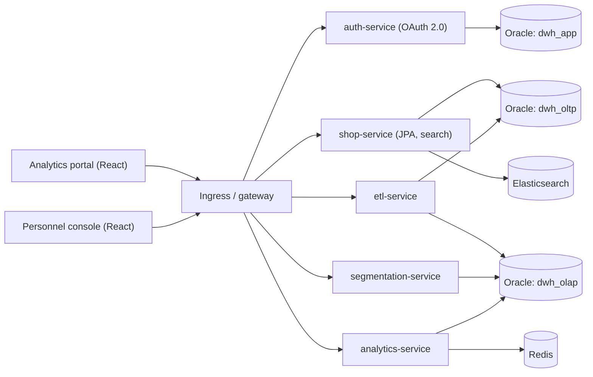

# E-Commerce Data Warehouse and Customer Behavior Analysis System

Term project, Yildiz Technical University, Graduate School of Science and Engineering, Computer Engineering,
Information Technologies, 2026.

## 1. Goal and scope

The project turns the order data of an online shop into a data warehouse and uses it to answer business questions about
sales and customers. It follows the steps of the assignment:

1. generate an OLTP data set with the TPC-C workload (BenchBase),
2. transform the OLTP schema into an OLAP schema,
3. design a star schema,
4. load it with ETL processes,
5. serve analytical reports,
6. segment the customers (RFM and K-Means).

Around this core the project provides what a shop analytics team needs to use the results: a secured API, a public
analytics portal, a personnel console, product search, automated tests and a deployment on containers and Kubernetes.

The data set at the scale used for all figures in this report:

| Item | Count |
|---|---|
| Warehouses (shops) | 10 |
| Customers | 300,000 (155,864 of them have ordered) |
| Products | 100,000 in 8 categories |
| Orders | 304,519 (2024-01-01 to 2026-11-01) |
| Order lines | 3,046,282 |
| Revenue | TRY 770,123,295.28 |
| Units sold | 15,254,227 |

## 2. Architecture

| Part | Technology |
|---|---|
| Back-end | Java 21, Spring Boot 4, Maven; JDBC for the set-based loads and reports, Spring Data JPA with Hibernate for the shop data |
| Front-end | React 19, Redux Toolkit, Axios, react-router; English and Turkish |
| Database | Oracle (Free 23ai in Docker), four accounts: OLTP, OLAP, application, read-only reports |
| Cache and search | Redis (report cache), Elasticsearch 9 (product search) |
| Security | OAuth 2.0 / OpenID Connect with Spring Authorization Server; authorization code flow with PKCE for the browsers |
| Containers | Docker images for every service and web app; Kubernetes manifests with kustomize; GitLab CI/CD |
| Tests | JUnit and Mockito, Jest, Postman (newman), Selenium |

Design decisions:

- **Set-based ETL.** Every ETL step is one SQL statement that Oracle runs itself. Four million rows never pass through
  the JVM, so a full rebuild takes about 8 minutes (10 minutes on a loaded machine).
- **Merged services.** The roadmap allowed merging the catalog and order services; they are one `shop-service`. The
  segmentation service is separate because it runs long jobs.
- **Gateway as configuration.** Routing is done by an nginx configuration (compose) and by the Kubernetes ingress.
  Each service validates the access token itself, so no service trusts the network.

## 3. OLTP data (TPC-C)

BenchBase creates the TPC-C tables in the `dwh_oltp` account and loads them (`database/scripts/load-oltp.ps1`, scale
factor 10, then a short transaction workload). TPC-C describes a wholesale supplier, not an online shop, so
`database/enrichment/01_enrich_oltp.sql` adds what a warehouse for e-commerce needs:

- product category and brand (8 categories, 12 brands),
- a Turkish city and region per warehouse and a region and e-mail per customer,
- order dates spread from 2024-01-01 to 2026-11-01, a payment method per order,
- delivery dates on delivered order lines and payment dates in the history table,
- a skewed choice of the customer per order, so a few customers buy often and most rarely,
- real line amounts (TPC-C stores an amount of zero on delivered lines, which would give a shop without revenue).

Enrichment is repeatable and keeps TPC-C's structure, so the benchmark remains a valid OLTP workload.

## 4. Star schema

Two fact tables, one inventory snapshot and five dimensions in the `dwh_olap` account (diagram and source mapping in
`docs/star-schema.md`):

| Table | Grain / role |
|---|---|
| `fact_sales` | one order line (quantity, amount, delivery days); partitioned by year |
| `fact_orders` | one order (lines, units, amount, delivered); partitioned by year |
| `fact_inventory_snapshot` | stock of a product in a warehouse per snapshot day |
| `dim_date` | one row per day 2024-2027 |
| `dim_customer` | slowly changing dimension type 2 (valid from/to, current flag) |
| `dim_product`, `dim_warehouse`, `dim_payment_method` | type 1 / fixed |

Supporting objects: ETL run history, steps, watermark and quality results; the materialized view `mv_sales_monthly`
(revenue per month, category and warehouse); segmentation result tables. All of it is created by versioned Flyway
migrations (`database/migrations`).

## 5. ETL

The ETL service (`etl-service`) loads the star schema:

| Step | What it does |
|---|---|
| Warehouse and product dimensions | `MERGE` (insert new, update changed) |
| Customer dimension | type 2: close the row of a customer whose city or region changed, add a current row |
| Order and sales facts | insert the orders after the watermark, joined to the dimension rows valid at the order date |
| Delivery refresh (incremental) | copy deliveries that happened after an order was loaded |
| Monthly view refresh | rebuild `mv_sales_monthly` |
| Inventory snapshot | replace today's snapshot |

A run is full (rebuild the facts) or incremental (orders after the watermark). A REST API starts runs in the background
(`202`, `409` while one is active) and shows the history with steps and quality checks. A nightly Kubernetes job starts
an incremental run.

Measured on the data set above (developer laptop):

| | Rows | Time |
|---|---|---|
| Order facts | 304,519 | 12 to 37 s |
| Sales facts | 3,046,282 | 5 to 9.5 min |
| Inventory snapshot | 1,000,000 | 2 to 2.5 min |
| Full run | 4,350,801 | 8 to 20 min (depends on machine load) |
| Incremental run without new orders | 1,000,000 (snapshot) | about 3 min |

Data quality. Each run compares the warehouse with the OLTP schema: order count, line count, sales amount, order
amount against sales amount, one current row per customer, no double current rows. All six checks pass on every run.
`database/scripts/run-reconciliation.ps1` repeats the comparison independently (also units, deliveries, revenue per
month, the monthly view); it caught real drift once, when test data had been added to the OLTP schema after the last run.

## 6. Reports and performance

`analytics-service` answers the shop's questions: overview figures, sales trend by day, week, month or year, top
products, categories, regions, payment methods, fulfillment, customer lifetime value and repeat purchases. Figures for
the whole period:

| | Value |
|---|---|
| Average order value | TRY 2,528.98 |
| Delivered share / average delivery time | 70.4 % / 4.0 days |
| Repeat purchase rate | 40.4 % of the customers who ordered (62,981) |
| Average orders per customer | 1.95 |
| Average customer lifetime value | TRY 4,941 |
| Payment methods | credit card 60.0 %, cash on delivery 20.0 %, wallet 10.0 %, bank transfer 9.9 % |
| Categories | between 12.3 % (home and kitchen) and 12.9 % (grocery) of the revenue |

Performance. The same question (revenue per month and category, 280 result rows) on three sources:

| Source | Time | Speed-up |
|---|---|---|
| OLTP tables (`order_line` join `oorder` join `item`) | 0.9 to 1.6 s | 1 |
| Star schema (`fact_sales` join `dim_date` join `dim_product`) | 0.8 to 1.9 s | 0.8 to 1.1 |
| Materialized view `mv_sales_monthly` | 2 to 5 ms | 260 to 430 |

The star schema alone brings no clear gain at this size (the measurements vary between a little slower and a little
faster than the OLTP tables): both read 3 million rows, and the star schema adds joins to the dimensions. The gain comes from what the warehouse makes possible, pre-aggregation (the view) and
partition pruning for date filters, together with the report cache (a repeated report is answered from Redis in about
20 ms). The cache key contains the number of the last successful ETL run, so a new run makes old entries unreachable
without any cross-service call.

## 7. Customer segmentation

`segmentation-service` calculates, for the 155,864 customers who ordered:

- **RFM.** Recency (days since the last order), frequency (orders) and monetary value (sum of order amounts), each
  scored from 1 to 5. Recency and monetary scores use `CUME_DIST`; the frequency score uses `PERCENT_RANK`, because more
  than half of the customers ordered once and must all get the lowest frequency score. Seven segments follow from the
  scores:

| Segment | Customers | Share | Avg recency (days) | Avg orders | Avg spend (TRY) | Revenue (TRY) |
|---|---|---|---|---|---|---|
| Champions | 19,064 | 12.2 % | 117 | 5.9 | 14,857 | 283.2 million |
| Loyal Customers | 30,988 | 19.9 % | 242 | 2.3 | 5,726 | 177.4 million |
| At Risk | 12,929 | 8.3 % | 657 | 2.3 | 5,745 | 74.3 million |
| Lost | 27,676 | 17.8 % | 884 | 1.0 | 2,531 | 70.0 million |
| New Customers | 25,695 | 16.5 % | 144 | 1.0 | 2,551 | 65.5 million |
| Hibernating | 21,865 | 14.0 % | 608 | 1.0 | 2,530 | 55.3 million |
| Promising | 17,647 | 11.3 % | 387 | 1.0 | 2,508 | 44.3 million |

  The champions are 12 % of the customers and bring 37 % of the revenue. At Risk customers spent as much as loyal
  ones but have not ordered for almost two years: the group to win back first.

- **K-Means.** Own implementation (k-means++ initialization with a fixed seed, so runs are reproducible) on the
  standardized logarithms of the three values. The model is fitted for k = 2 to 8 and the elbow of the inertia curve
  chooses k (here 4; inertia 259,720 for k = 2 down to 80,273 for k = 8). The clusters, numbered by average spend:

| Cluster | Customers | Avg recency (days) | Avg orders | Avg spend (TRY) |
|---|---|---|---|---|
| 0 Active high value | 9,892 | 106 | 8.6 | 21,918 |
| 1 Active high value 2 | 42,737 | 371 | 2.4 | 6,258 |
| 2 Recent low spenders | 21,540 | 64 | 1.5 | 3,754 |
| 3 Dormant low value | 81,695 | 590 | 1.0 | 2,509 |

A run is started by an administrator, by the nightly schedule when a newer ETL run exists, or through the API.

## 8. Services and security

Each service is a Spring Boot application with `local`, `development` and `production` profiles (production has no
fallback values). The auth service is an OAuth 2.0 / OpenID Connect authorization server: the React apps use the
authorization code flow with PKCE (public clients), the nightly job uses the client credentials flow. Tokens carry the
role of the user:

| Role | Rights |
|---|---|
| ADMIN | everything: users, data changes, ETL, segmentation, search index |
| ANALYST | read everything (customers, segments, ETL history), change nothing |
| VIEWER | the public portal's dashboards and product search |

Every resource server validates the token itself. The report API connects with a read-only database account; writing
with it is refused by Oracle.

## 9. Front-end

Two React applications from the same base: the **analytics portal** (public, mobile first: filter bar with period
presets, KPI cards, sales trend with accessible SVG chart, top products, categories, regions, payments, fulfillment,
customer widgets for analysts, product search with typeahead and facets) and the **personnel console** (dashboard,
customers, products with catalog and smart search, warehouses, orders with lines, ETL runs, segments with RFM heat
grid and K-Means clusters, users). Common rules: page titles centered, no "return to homepage" button, vector icons
only, tables with sortable columns, a search box with a magnifier icon at the top left and the create button at the top
right, English and Turkish, responsive, charts with a table alternative, dark theme through the system setting.

Because the authorization server gives no refresh tokens to public clients, the apps sign in again silently after a
reload or an expired token and return to the page that was open.

## 10. Product search

`shop-service` indexes the 100,000 products in Elasticsearch (full index in 11 seconds, alias switch without downtime,
after-commit synchronization of product changes). Search works in English and Turkish (the Turkish analyzer folds
accents, so `kozmetik` finds "Kozmetik ve Bakım"), offers typeahead suggestions, filters (category, brand, price) and
facets.

## 11. Testing

See `docs/testing.md`. Summary: 336 back-end and 343 front-end unit tests, 55 Postman requests with 48 checks, 63
Selenium browser tests (desktop, tablet and phone layouts, three roles) and the data reconciliation. The tests found
and led to the fixes of several real defects (listed in that document).

## 12. Deployment and operations

Docker images for all seven applications, a compose profile that runs everything in containers, kustomize manifests
(deployments with probes and a hardened security context, ingress for three host names, autoscaling, nightly ETL job)
with development and production overlays, and a GitLab pipeline (tests, image builds, database migrations,
automatic development deployment, manual production approval). Details in `deploy/README.md` and
`docs/database-operations.md` (accounts, backup and restore, query plans, seeding).

## 13. Limitations and future work

- The sign-out of the React apps ends the browser's tokens but not the server session of the authorization server;
  a complete sign-out needs the OpenID Connect logout endpoint.
- The category filter of the portal applies to the top products list only; the other reports would need a category
  parameter in the API.
- Customer ids for new customers are the highest id of the district plus one without a lock; two simultaneous creations
  in one district could collide.
- Product changes made while a full search reindex runs reach only the old index.
- A date dimension has been generated up to 2027; a yearly job should extend it and add the next table partition.
- The Turkish translations were written without a native speaker's review.
- The Kubernetes manifests were rendered and checked, but not applied to a real cluster; host names, registry and
  secrets are placeholders to replace.
- Real shop events (clicks, carts) are not part of TPC-C; behavior analysis is based on orders only.

## 14. Repository

| Folder | Content |
|---|---|
| `services/` | the five Spring Boot services with their Postman collections |
| `web/` | the two React applications |
| `database/` | accounts, BenchBase configuration, enrichment, migrations, reconciliation |
| `deploy/` | gateway, Kubernetes, deployment notes |
| `e2e-tests/` | Selenium tests |
| `docs/` | this report, star schema, database operations, testing, demo script |
