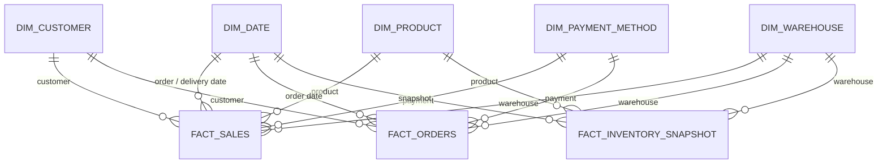

# Star Schema

The warehouse lives in the `dwh_olap` Oracle schema. The DDL is kept as versioned Flyway migrations in `database/migrations/olap/` and is applied with
`database/scripts/migrate-database.ps1 -Schema olap`.

## Fact tables

| Table | Grain | Measures |
|---|---|---|
| `fact_sales` | One order line | `quantity`, `sales_amount`, `delivery_days` |
| `fact_orders` | One order | `line_count`, `item_quantity`, `order_amount`, `is_delivered` |
| `fact_inventory_snapshot` | Product and warehouse per snapshot day | `quantity_on_hand`, `units_sold_ytd`, `order_count` |

`fact_sales` and `fact_orders` are range partitioned by `order_date_key` (one partition per year plus an
overflow partition). The order number (`order_w_id`, `order_d_id`, `order_id`) is kept in the fact tables as a
degenerate dimension.

## Dimension tables

| Table | Source | History handling |
|---|---|---|
| `dim_date` | Generated (2024-01-01 to 2027-12-31) | None |
| `dim_customer` | `customer` | Type 2: `valid_from`, `valid_to`, `is_current` |
| `dim_product` | `item` | Type 1: overwritten |
| `dim_warehouse` | `warehouse` | Type 1: overwritten |
| `dim_payment_method` | Fixed list | None |

## ETL support tables

`etl_run`, `etl_step`, `etl_watermark` and `etl_quality_result` record every ETL run, the rows handled per
step, the last loaded order date and the outcome of the data quality checks.

## Source mapping

| Warehouse column | OLTP source |
|---|---|
| `fact_sales.sales_amount` | `order_line.ol_amount` |
| `fact_sales.quantity` | `order_line.ol_quantity` |
| `fact_sales.delivery_days` | `order_line.ol_delivery_d - oorder.o_entry_d` |
| `fact_orders.order_amount` | sum of `order_line.ol_amount` per order |
| `dim_product.category`, `brand` | `item.i_category`, `item.i_brand` |
| `dim_warehouse.region` | `warehouse.w_region` |
| `dim_customer.region` | `customer.c_region` |
| `payment_method` | `oorder.o_payment_method` |
